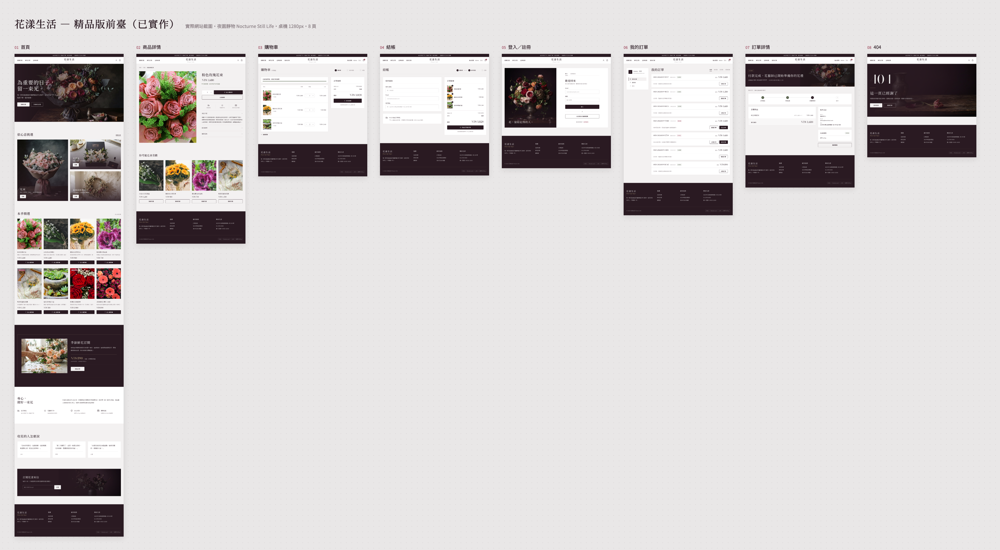
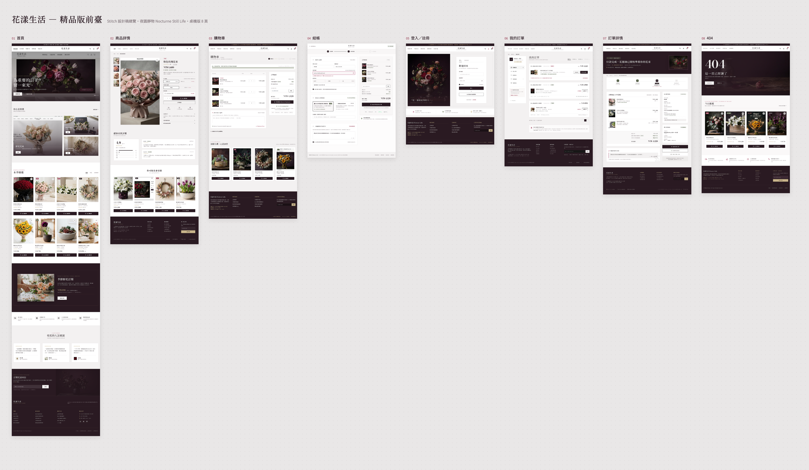

# 花卉電商網站（backend-project）

花卉電商全端應用，提供前台商品瀏覽、購物車、訂單管理，以及後台商品與訂單管理功能。支援訪客購物車（X-Session-Id）與會員登入（JWT）雙模式。

## 畫面總覽

前臺採「夜園靜物 Nocturne Still Life」精品風格（設計稿：Stitch 專案「花漾生活 — 精品版前臺」）。下圖為實際網站的 8 個前臺頁面，點圖可看原尺寸。

[](./design/implemented/00-canvas-overview.png)

| 頁面 | 已實作 | 設計稿 |
|------|--------|--------|
| 首頁 | [截圖](./design/implemented/01-home.png) | [設計稿](./design/01-home.png) |
| 商品詳情 | [截圖](./design/implemented/02-product-detail.png) | [設計稿](./design/02-product-detail.png) |
| 購物車 | [截圖](./design/implemented/03-cart.png) | [設計稿](./design/03-cart.png) |
| 結帳 | [截圖](./design/implemented/04-checkout.png) | [設計稿](./design/04-checkout.png) |
| 登入／註冊 | [截圖](./design/implemented/05-login.png) | [設計稿](./design/05-login.png) |
| 我的訂單 | [截圖](./design/implemented/06-orders.png) | [設計稿](./design/06-orders.png) |
| 訂單詳情 | [截圖](./design/implemented/07-order-detail.png) | [設計稿](./design/07-order-detail.png) |
| 404 | [截圖](./design/implemented/08-404.png) | [設計稿](./design/08-404.png) |

<details>
<summary>Stitch 設計稿總覽</summary>

[](./design/00-canvas-overview.png)

設計稿中的部分問題（重複導覽列、英文全大寫小標、商品圖為網頁截圖）已在實作時修正，並依 API 實際提供的資料調整內容（例如未實作評分、規格選項與優惠碼），因此實際網站與設計稿略有差異。

</details>

## 技術棧

| 分類 | 技術 | 版本 |
|------|------|------|
| 執行環境 | Node.js | — |
| Web 框架 | Express | ~4.16.1 |
| 資料庫 | SQLite（better-sqlite3） | ^12.8.0 |
| 模板引擎 | EJS | ^5.0.1 |
| CSS 框架 | Tailwind CSS | ^4.2.2 |
| 認證 | JSON Web Token（jsonwebtoken） | ^9.0.2 |
| 密碼雜湊 | bcrypt | ^6.0.0 |
| ID 生成 | uuid（v4） | ^11.1.0 |
| CORS | cors | ^2.8.5 |
| 環境變數 | dotenv | ^16.4.7 |
| API 文件 | swagger-jsdoc | ^6.2.8 |
| 測試框架 | Vitest | ^2.1.9 |
| HTTP 測試 | supertest | ^7.2.2 |
| E2E 測試 | Playwright MCP（@playwright/mcp，經 Claude Code 執行） | latest |

## 快速開始

```bash
# 1. 安裝依賴
npm install

# 2. 設定環境變數
cp .env.example .env
# 編輯 .env，至少設定 JWT_SECRET

# 3. 啟動伺服器（含 CSS 編譯）
npm run start
# 伺服器預設在 http://localhost:3001

# 4. 開發模式（分別啟動）
npm run dev:server   # 啟動 Express 伺服器
npm run dev:css      # Tailwind CSS watch 模式

# 5. 執行測試
npm run test

# 6. 生成 OpenAPI 文件
npm run openapi
```

### 預設帳號

| 角色 | Email | 密碼 |
|------|-------|------|
| 管理員 | admin@hexschool.com | 12345678 |

管理員帳號在伺服器首次啟動時自動建立（可透過 `ADMIN_EMAIL` / `ADMIN_PASSWORD` 環境變數自訂）。

## 常用指令

| 指令 | 說明 |
|------|------|
| `npm run start` | 編譯 CSS + 啟動伺服器 |
| `npm run dev:server` | 僅啟動伺服器 |
| `npm run dev:css` | Tailwind CSS watch 模式 |
| `npm run css:build` | 編譯並壓縮 CSS |
| `npm run test` | 執行全部測試 |
| `npm run openapi` | 生成 openapi.json |

## 自動測試

專案有兩層自動測試：API 整合測試與瀏覽器 E2E 測試。詳細規範見 [TESTING.md](./TESTING.md)。

### API 整合測試（Vitest + supertest）

| 項目 | 說明 |
|------|------|
| 工具 | [Vitest](https://vitest.dev/)（測試執行器）＋ [supertest](https://github.com/ladjs/supertest)（直接對 Express app 發 HTTP 請求，不需啟動伺服器） |
| 範圍 | `tests/` 下 6 個測試檔：認證、商品、購物車、訂單、後台商品、後台訂單 |
| 執行 | `npm run test`（依 `vitest.config.js` 指定順序循序執行） |
| 前置條件 | `.env` 須設定 `JWT_SECRET` |

> 測試會直接寫入開發用的 `database.sqlite`（新增測試帳號與訂單）。

### 瀏覽器 E2E 測試（Playwright MCP）

| 項目 | 說明 |
|------|------|
| 工具 | [Claude Code](https://claude.com/claude-code) 專案 skill `e2e-ecpay-checkout`，透過 Playwright MCP（`.mcp.json` 設定）操作本機 Google Chrome |
| 流程 | 登入 → 加入購物車 → 結帳 → 綠界測試環境選「網路ATM ＋ 臺灣土地銀行」付款 → 返回商店，驗證訂單狀態為 `paid`、購物車清空、訂單時間以台北時間顯示 |
| 執行 | 在 Claude Code 輸入 `/e2e-ecpay-checkout`（或說「跑結帳 E2E」） |
| 截圖 | 每一步存一張到 `e2e-artifacts/<時間戳>/`（`01-home` ～ `09-order-paid`，不進版本控制），結束時逐張列在回報中 |
| 前置條件 | 第一次使用需重啟 Claude Code 並在 `/mcp` 核准 playwright；`.env` 須有 `ADMIN_EMAIL`、`ADMIN_PASSWORD`，且 `ECPAY_ENV=staging` |

- 只在綠界測試環境付款，不會實際扣款；`ECPAY_ENV` 不是 `staging` 時 skill 會拒絕執行
- 3001 未啟動時 skill 會自行啟動，並只在測試成功後關閉自己啟動的伺服器
- 綠界測試環境偶爾停在「交易資料傳輸中」，skill 會等待最多 90 秒並自動重試最多 2 次
- 流程定義見 [`.claude/skills/e2e-ecpay-checkout/SKILL.md`](../.claude/skills/e2e-ecpay-checkout/SKILL.md)

## 文件索引

| 文件 | 說明 |
|------|------|
| [ARCHITECTURE.md](./ARCHITECTURE.md) | 架構、目錄結構、資料流 |
| [DEVELOPMENT.md](./DEVELOPMENT.md) | 開發規範、命名規則、計畫歸檔流程 |
| [FEATURES.md](./FEATURES.md) | 功能列表與完成狀態（含行為描述） |
| [TESTING.md](./TESTING.md) | 測試規範與指南 |
| [CHANGELOG.md](./CHANGELOG.md) | 更新日誌 |
| [design/](./design/) | Stitch 設計稿截圖；[design/implemented/](./design/implemented/) 為實際網站截圖 |
| [plans/](./plans/) | 開發計畫目錄 |
| [plans/archive/](./plans/archive/) | 已完成計畫歸檔 |
